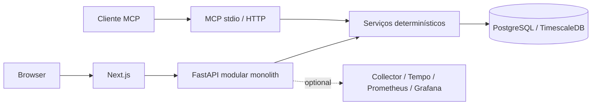

# N55 Intelligence Lab

**Vehicle Intelligence Platform** — engenharia automotiva orientada a dados.
A primeira implementação será estudada com uma BMW 335i F30/N55. O objetivo é transformar
telemetria e documentação em análises explicáveis e auditáveis.

## Estado atual

Fases 0–5 passaram pela auditoria retrospectiva. A Fase 6 expõe ferramentas e resources MCP
somente leitura; a evidência de entrega está no [relatório de aceitação](docs/validation/phase-6-acceptance.md).
A Fase 5 fornece analytics determinísticos e versionados sobre telemetria, sessões, pulls,
eventos factuais e configurações históricas. A Fase 4 fornece aquisição somente leitura,
receitas, preflight e streaming durável. As Fases 7A/7B fornecem agentes fundamentados
e investigação com aprovação explícita. A Fase 7C está em implementação e validação.
Diagnóstico/root cause, RAG e ML permanecem planejados. Veja [a arquitetura de analytics](docs/architecture/phase-5-automotive-analytics.md).
Veja [a arquitetura de telemetria](docs/architecture/phase-1-telemetry.md) e o
[desenho de análise da Fase 2](docs/architecture/phase-2-session-analysis.md) e o
[desenho de eventos da Fase 3](docs/architecture/phase-3-event-anomaly-engine.md), o
[desenho de aquisição da Fase 4](docs/architecture/phase-4-live-acquisition.md), além do
[relatório histórico da Fase 0](docs/roadmap/phase-0-completion-report.md).



## Quick start

Node 24.19.0, pnpm 11.19.0, Python 3.12.14, uv 0.12.19, Docker/Compose v2 e Make.

```bash
make bootstrap
make up
```

Web http://localhost:3000 · API http://localhost:8000/docs.
`make down` preserva dados locais. `.env` contém apenas configuração local e não deve ser versionado.

## Desenvolvimento e testes

`make check-api`, `make check-web`, `make contracts`, `make test-integration` e `make verify`.
No Codex Cloud, use `make verify-cloud` para todos os checks que não dependem de containers.
O workflow GitHub Actions `full-validation` é o executor canônico de Docker/full-stack; checks
dependentes de Docker permanecem `CI REQUIRED` até esse workflow passar.
Instale Chromium e scanners conforme [desenvolvimento local](docs/development/local-development.md)
e [automação de segurança](docs/security/automation.md). O gate completo requer Docker e downloads públicos.

## Observabilidade

`make observability-up` habilita o profile opcional. Grafana: http://localhost:3001.
Veja [instrumentação e verificação](docs/observability/README.md).

## Arquitetura e continuidade

[Contexto](docs/architecture/system-context.md) · [toolchain](docs/architecture/toolchain.md) ·
[ADRs](docs/adr) · [testes](docs/testing/strategy.md) · [threat model](docs/security/threat-model.md) ·
[roadmap](docs/roadmap/README.md) · [contribuição](CONTRIBUTING.md).

## Safety boundary

Observação, diagnóstico, análise, simulação, pesquisa e recomendações técnicas.
Nenhum controle de acelerador, freios, direção, tuning ou flash/ECU automático.
Dados veiculares podem ser incompletos ou ruidosos; conclusões futuras devem indicar evidência e incerteza.

## Phase 6 MCP

The read-only MCP interface exposes 22 typed tools and three contextual JSON resources through
stdio and authenticated Streamable HTTP, using official SDK 2.0.0. It preserves Phase 5 evidence
and provenance without persisting reads. No LLM, agent, RAG or diagnosis is added.
See [architecture](docs/architecture/phase-6-mcp-tool-platform.md),
[runbook](docs/runbooks/mcp-server.md) and [acceptance](docs/validation/phase-6-acceptance.md).
Run `make test-mcp`, `make phase6-acceptance`, `make test-mcp-e2e`, `make benchmark-mcp`.
`make mcp-up` starts the optional container process with a provisioned local token.

## Phase 7A grounded agent

Implemented: see [acceptance evidence and delivery audit](docs/validation/phase-7a-acceptance.md).
The vehicle workspace supports natural-language questions, bounded progress/streaming, confidence,
grounded findings, configuration/modification context, evidence and MCP audit. One typed LangGraph
orchestrator uses the official MCP client and a provider adapter. The real adapter uses OpenAI
Responses; reproducible CI uses the same graph with a deterministic provider. Agent execution is
disabled by default and requires explicit server-side provider/MCP configuration.

The agent reads actual vehicle facts through MCP. The catalog now has 23 tools with the additive
configuration-list read. Temporal association never proves mechanical causation. No ECU control,
unsupported diagnosis, specialist agents or RAG is available.
See [architecture](docs/architecture/phase-7a-grounded-agent.md) and
[operation/configuration](docs/runbooks/grounded-agent.md).

## Phase 7B investigation and adaptive logging

Phase 7B extends a completed insufficient answer into a bounded investigation. Candidate
hypotheses and evidence gaps are checked against current-run evidence and existing MCP data.
Semantic signal needs map to the canonical registry; Phase 4 alone supplies recipe contents,
hashes, sampling rates and preflight. An operator reviews and approves an exact plan version and
recipe hash. The local read-only collector is started explicitly outside the agent. A finalized,
matching session can then be linked for a separate grounded follow-up run. The workflow does not
claim a mechanical diagnosis or automatically repeat capture. See the
[architecture](docs/architecture/phase-7b-investigation-adaptive-logging.md),
[runbook](docs/runbooks/investigation-workflow.md) and
[acceptance ledger](docs/validation/phase-7b-acceptance.md).

## Phase 7C supervisor and specialists

The bounded Supervisor selects Data Quality, Performance, Thermal and Fuel/Air/Boost through
typed routing, immutable MCP permissions and existing Phase 7A grounding. Factual lookups can use
zero specialists. Unreliable telemetry blocks deeper interpretation; unresolved competing mechanisms
use the existing Phase 7B approval and follow-up workflow. Phase 7C is VERIFIED on the canonical GitHub gates for PR #35; see the current roadmap.
See [architecture](docs/architecture/phase-7c-specialist-agents-supervisor.md),
[runbook](docs/runbooks/supervisor-specialists.md),
[acceptance](docs/validation/phase-7c-acceptance.md) and
[traceability ledger](docs/validation/phase-7c-traceability-ledger.md).

`make test-supervisor`, `make phase7c-acceptance`, `make test-supervisor-e2e`,
`make benchmark-supervisor` and `make supervisor-observability` are the dedicated gates.
Deterministic CI needs no paid provider credentials. Phase 7D owns comprehensive real-model
routing, quality, latency, token and cost evaluation; Phase 8 owns RAG.

## Phase 7D real-model reliability evaluation

The versioned evaluation covers 80 unique questions and 40 critical repeats with GPT-6 Luna,
Flex and low reasoning. Paid execution requires explicit confirmation, a clean committed SHA
and local credentials. Normal CI tests the harness deterministically. See the
[runbook](docs/runbooks/phase-7d-real-evaluation.md),
[architecture](docs/architecture/phase-7d-real-model-validation.md) and
[current evaluation report](docs/validation/phase-7d-real-evaluation.md).
Phase 7D is **completed with an operator-accepted validation caveat**: all 120 scheduled slots
have PASS observations across multiple rounds; an additional complete run on the final code
was not performed because the remaining API balance was insufficient. This does not establish
a uniformly verified final-source real baseline. See the report for exact sources, costs
and the separate final GitHub Actions status.

## Phase 8 technical knowledge (complete)

Phase 8 adds versioned PostgreSQL/pgvector documentary evidence alongside read-only MCP vehicle
facts. The initial reviewed local corpus targets BMW F30 335i / N55. Unknown tuner/map details
remain partial applicability; Stage 2 never supplies a universal pressure or boost target.

See [architecture](docs/architecture/phase-8-technical-rag.md),
[source research](docs/knowledge/n55-source-research.md),
[controlled ingestion](docs/runbooks/knowledge-ingestion.md) and
[current acceptance](docs/validation/phase-8-acceptance.md). `make phase8-embed-corpus` is a
dedicated explicitly confirmed paid operation under a cumulative USD 2 ceiling. Ordinary validation
and the cache-only `make phase8-retrieval-eval` never buy embeddings. Corrected implementation
acceptance is recorded in [the Phase 8 report](docs/validation/phase-8-acceptance.md); its separate
Phase 7D paid-suite caveat remains documented there.

## Phase 9A feature engineering foundation

Phase 9A adds a deterministic 79-definition feature registry, immutable feature-set versions,
provenance and temporal cutoffs, configuration-aware history, a leakage-safe pull dataset builder,
JSONL/manifest export, profiling and bounded operator CLIs. It does not train models, generate
predictions, diagnose vehicle conditions, expose a public feature API or add a predictive UI.
See the [architecture](docs/architecture/phase-9a-feature-engineering.md),
[feature generation runbook](docs/runbooks/feature-generation.md),
[dataset runbook](docs/runbooks/dataset-builder.md), and
[acceptance report](docs/validation/phase-9a-acceptance.md).

Run `make test-features`, `make test-feature-integration`, `make phase9a-acceptance`,
`make benchmark-features`, and `make feature-observability` for focused gates. These use a fresh
disposable TimescaleDB for database-backed checks. `make verify` includes all five Phase 9A gates.
Phase 9B adds only the offline supervised model-training and evaluation foundation for observable
next-pull behavior. It does not diagnose failures, serve predictions, or control the vehicle.
Phase 9C at `c4da7f5` is **VERIFIED** and merged into baseline `7fc4c59` after PR #43 passed its
canonical full-validation, CI and Security checks. It adds offline anomaly scoring against exact
same-vehicle/configuration/source references. Scores are statistical deviations, not fault
diagnoses or failure probabilities. Phase 9D and 9E are merged, and Phase 9F is included in merged
baseline `327c63f35b4e7bc0eba31bbec81d20206be8afa2`. Phase 9G's offline evaluation and
research-only calibration foundation is implemented on its dedicated branch; its exact-head PR
checks and canonical full-stack gate determine verified delivery. Real-world calibration remains
`NOT_ESTABLISHED`. Phase 9H remains planned. See the
[Phase 9B architecture](docs/architecture/phase-9b-predictive-models.md),
[training runbook](docs/runbooks/model-training.md), and [acceptance report](docs/validation/phase-9b-acceptance.md),
plus the [Phase 9C architecture](docs/architecture/phase-9c-anomaly-detection.md),
[runbook](docs/runbooks/anomaly-detection.md), [acceptance report](docs/validation/phase-9c-acceptance.md),
[model evaluation](docs/validation/phase-9c-model-evaluation.md), and
[traceability ledger](docs/validation/phase-9c-traceability-ledger.md).

Run `make test-anomalies` and `make phase9c-acceptance` for focused 9C checks. The acceptance
uses a fresh disposable TimescaleDB and records controlled synthetic evidence under ignored
`.validation/phase9c/`.

## Phase 9D controlled prediction service

Phase 9D adds authenticated, bounded HTTP inference for explicitly approved Phase 9B supervised
models and Phase 9C anomaly detectors, with durable immutable receipts. It is disabled by default,
restricted to development/test, and cannot be enabled in production. It does not add public or
multi-tenant authorization. Engineering scores are not failure probabilities or diagnoses. See the
[architecture](docs/architecture/phase-9d-prediction-service.md),
[operator runbook](docs/runbooks/prediction-service.md),
[acceptance record](docs/validation/phase-9d-acceptance.md),
[evaluation](docs/validation/phase-9d-model-serving-evaluation.md), and
[traceability ledger](docs/validation/phase-9d-traceability-ledger.md).

## Phase 9E prediction evidence

Phase 9E adds immutable, cutoff-aware provenance for an existing Phase 9D receipt. Its typed graph
links the original decision to the exact 9D approval event, 9A FeatureSet, 9B model or 9C
finding/run/reference. Supervised `NEXT_PULL` and anomaly `AFTER_PULL_OFFLINE` remain separate.
Scores remain engineering outputs, not mechanical failure probabilities or diagnoses. The service
reuses 9D's controlled access boundary and adds no agent, MCP, predictive UI, calibration, public
tenancy or ECU-control surface.

See the [architecture](docs/architecture/phase-9e-prediction-evidence.md),
[operator runbook](docs/runbooks/prediction-evidence.md),
[acceptance report](docs/validation/phase-9e-acceptance.md),
[evaluation narrative](docs/validation/phase-9e-evidence-evaluation.md),
[traceability ledger](docs/validation/phase-9e-traceability-ledger.md) and
[ADR 0043](docs/adr/0043-phase9e-prediction-evidence.md). Run
`make test-prediction-evidence` for focused contracts and `make phase9e-acceptance` for the actual
HTTP/database gate. The benchmark and observability targets consume the same ignored acceptance
receipt. Docker-dependent results are CI REQUIRED without a usable Docker daemon.

## Phase 9F controlled agent integration

Phase 9F lets an explicitly authorized development/test agent read exact, already materialized 9E
evidence through a separate MCP scope. The integration is disabled by default and rejected in
production. It adds no inference, materialization, collection, diagnosis, vehicle control, predictive
dashboard or general user/tenant authorization. 9B `NEXT_PULL` and 9C `AFTER_PULL_OFFLINE` remain
distinct; the application validates source facts and renders bounded claims with run-local citations.

See the [architecture](docs/architecture/phase-9f-agent-integration.md),
[operator runbook](docs/runbooks/prediction-agent-integration.md),
[acceptance report](docs/validation/phase-9f-acceptance.md),
[evaluation record](docs/validation/phase-9f-agent-evaluation.md),
[137-section traceability ledger](docs/validation/phase-9f-traceability-ledger.md),
[security boundary](docs/security/threat-model.md#phase-9f-agent-prediction-integration), and
[ADR 0044](docs/adr/0044-phase9f-agent-prediction-boundary.md). Run
`make test-prediction-agent-integration` for focused contracts. `make phase9f-acceptance` exercises
the real 9E disposable database, official MCP client and LangGraph agent; benchmark and
observability targets report measurements from that receipt. Docker-dependent results are CI
REQUIRED without a usable Docker daemon. Synthetic acceptance does not establish real-vehicle
accuracy or production readiness.

## Phase 9G offline evaluation and calibration

Phase 9G evaluates the registered Phase 9B next-pull models and Phase 9C detectors over the
canonical 9A feature pipeline with chronological session, vehicle, and configuration holdouts.
Calibration candidates are research-only; validation selects candidates, held-out test data remains
untouched until scoring, and original model/detector artifacts and thresholds remain frozen. The
workflow reports reliability, uncertainty, abstentions, false-alarm/cross-family burden, drift, and
source applicability with an independent arithmetic and provenance checker. It does not add
inference, promotion, a public endpoint, agent confidence, or a predictive UI.

See the [architecture](docs/architecture/phase-9g-evaluation-calibration.md),
[operator runbook](docs/runbooks/predictive-reliability.md),
[acceptance record](docs/validation/phase-9g-acceptance.md),
[evaluation report](docs/validation/phase-9g-evaluation.md),
[175-section traceability ledger](docs/validation/phase-9g-traceability-ledger.md),
[security boundary](docs/security/threat-model.md#phase-9g-offline-evaluation-and-calibration), and
[ADR 0045](docs/adr/0045-phase9g-offline-evaluation.md). Run
`make test-evaluation-calibration` for focused contracts and `make phase9g-acceptance` for the
disposable database, migration, registered-artifact, and independent-checker gate. Benchmark and
observability commands render only from the same current-SHA receipt. Real-world predictive
validity and calibration remain `NOT_ESTABLISHED` without verified outcomes. Docker-dependent
acceptance is `CI REQUIRED` without a usable daemon.
