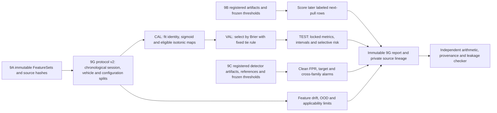

# Phase 9G offline evaluation and calibration

Phase 9G adds a research-only evaluation pipeline over the canonical Phase 9A feature snapshots,
the registered Phase 9B next-pull models, and the registered Phase 9C anomaly detectors. It does
not add an HTTP route, inference adapter, MCP tool, agent capability, production calibration
store, model-promotion path, or user interface.

## Protocol and partitions

The protocol is `phase9g-protocol-v2`, serialized under schema `phase9g-evaluation-v1`, with a
canonical SHA-256 checksum. The protocol freezes the three Phase 9B tasks, four Phase 9C feature
families, two detector methods, three calibration methods, reliability bins, support floors,
bootstrap policy, split fractions, row/artifact bounds, threshold policy, and the ban on promotion.

The evaluator first trains each existing 9B task through its registered offline pipeline on the
earlier synthetic training cohort. Evaluation rows then come from later whole sessions and are
partitioned chronologically into calibration, validation, and held-out test windows. A session,
physical pull, vehicle, or configuration cannot appear in more than one partition, and every
evaluation window is later than model training. The runner verifies these constraints again after
the split. It keeps original 9B target horizons and frozen thresholds.

The offline 9G source fixture uses three later time windows (June through August 2026), each with
four synthetic vehicles, five sessions per vehicle, and five pulls per session. This yields three
disjoint vehicle/configuration cohorts for calibration, validation, and final test. The held-out
pull IDs are preselected from these fixture receipts and passed as a bounded allowlist to the
canonical 9A dataset builder; requested and materialized cohort fingerprints must match, and no
training pull may enter that dataset. The builder's existing 32 MiB source-payload limit remains in
force. The earlier 9B training fixture keeps its original default cohort and generator ordering;
no registered model artifact or serving threshold is changed by this research-only fixture sizing.

Only calibration rows fit candidate maps. Sigmoid requires at least 40 rows, 10 examples of each
class, and 10 sessions. Isotonic requires 100 rows, 30 examples of each class, and 30 sessions.
An ineligible candidate is recorded as an explicit abstention. Validation alone selects among
eligible candidates by Brier score; ties within `1e-4` prefer identity, sigmoid, then isotonic.
Held-out test labels do not fit, select, or tune a candidate. Maps are bounded JSON with a checksum,
version, source/model/label lineage and an explicit `not_for_serving` fence; pickle is not used.

The supervised report includes Brier score, log loss, five-bin ECE and reliability rows, AUROC,
average precision, threshold confusion measures, subgroup support, OOD distances, and risk/coverage
points. Intervals use a deterministic session-cluster bootstrap over sorted SHA-256 session
fingerprints, so the independent checker reproduces the exact seeded samples without receiving raw
session IDs. Fewer than 20 independent sessions
are labeled descriptive with undefined intervals. Missing labels and unavailable signals remain
excluded from scored denominators and appear in explicit coverage/abstention counts.

## Anomaly, drift, and applicability

The evaluator consumes all eight existing Phase 9C family/method artifacts and the exact frozen
reference and threshold lineage. It reports clean false-alarm rates with both scored-clean and
eligible-clean denominators, target-family detections, cross-family alarms, quality abstentions,
and deterministic reference-size refits. It never interprets anomaly scores as probabilities or
health percentages. Scenario oracle metadata is held outside feature fitting and scoring.

Missing fuel pressure is an abstention only for the fuel detector, whose required input is absent.
Thermal, boost/air, and performance detectors retain their scores for that same case so missingness
can be measured as a separate confounder; those scores are not labeled fuel-fault detections.
Duplicate/low-quality telemetry is an abstention for every family.
Clean and intervention denominators start from all predeclared case attempts. Missing scores and
alarms stay in the eligible count and reduce coverage; reports show false-alarm rates per scored
and per attempted eligible clean case separately.

Drift is split into feature distribution, label prevalence, concept/performance, reliability, and
detector-reference comparisons. PSI and robust location shifts use the training reference only;
OOD thresholds also use training only. Labeled drift experiments are synthetic and explicitly
marked non-transferable. Unlabeled real or imported sources have `REAL_DATA_UNLABELED` status;
their feature availability/distribution does not establish concept or calibration drift.

Applicability records carry a bounded source role, required and observed signal coverage, outcome
support, context fingerprints, source fingerprint, allowed claim categories, and a reason code.
The fixture report records engine group, versioned configuration, effective modification and
synthetic telemetry source without vehicle identifiers. No mechanical failure label, target outcome,
or sensor reading is fabricated to fill a gap.

## Persistence and boundaries

Migration 0019 adds five bounded append-only tables: `evaluation_protocols`, `evaluation_runs`,
`evaluation_metric_reports`, `evaluation_calibration_candidates`, and
`evaluation_applicability_assessments`. Unique logical identity makes replay idempotent. Database
triggers reject `UPDATE`, `DELETE`, and `TRUNCATE`. The run links private hashes for the registered
9A feature schema, 9B label definitions and model artifacts, 9C definitions, reference datasets,
and detector artifacts. A read-only repeatable-read digest covers the allowlisted 9A–9F source
tables before and after evaluation persistence. Each JSONB report is checked against the 256 KiB
database limit before insertion. Supervised report rows retain the capped metric aggregates and
per-partition row counts/fingerprints/example-payload checksums; complete row-level score and label
evidence stays in the ignored `.validation/phase9g/acceptance.json` used by the independent checker.
The stored row also carries the checksum of its complete report, which is covered by the evaluation
run checksum. This keeps the durable registry compact without weakening the independent arithmetic
check or duplicating feature matrices in JSONB.

The scientific status is separate from engineering status. A passing implementation can report
`engineering_pipeline=PASS` while keeping real-world predictive validity and calibration
`NOT_ESTABLISHED`, production use `PROHIBITED`, and failure labels unavailable. Synthetic
calibration applies only to the named synthetic target population; it does not estimate mechanical
failure probability. Existing model artifacts, thresholds, serving approvals, PredictionEvidence,
and agent claims remain unchanged.

See the [operator runbook](../runbooks/predictive-reliability.md), [validation report](../validation/phase-9g-evaluation.md), [acceptance evidence](../validation/phase-9g-acceptance.md), [traceability ledger](../validation/phase-9g-traceability-ledger.md), and [ADR 0045](../adr/0045-phase9g-offline-evaluation.md).
