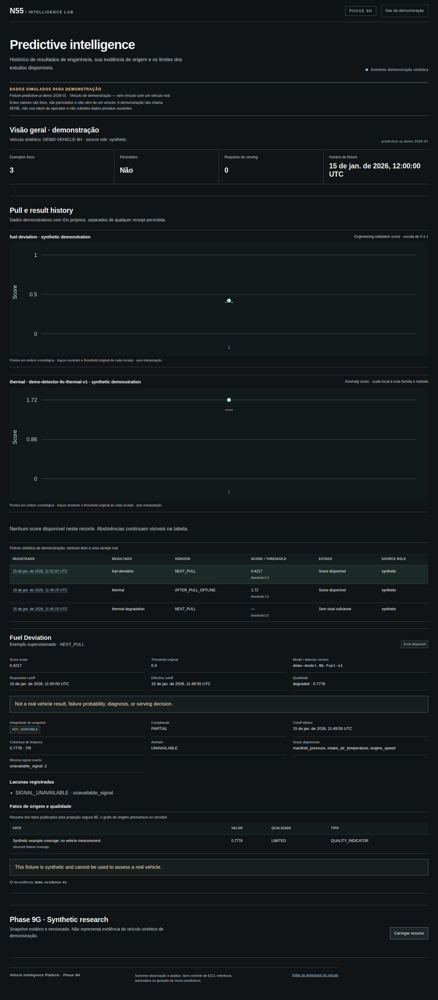
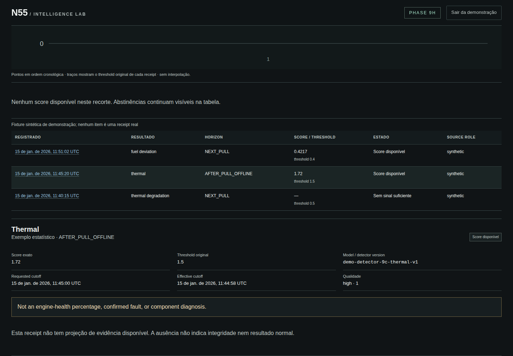
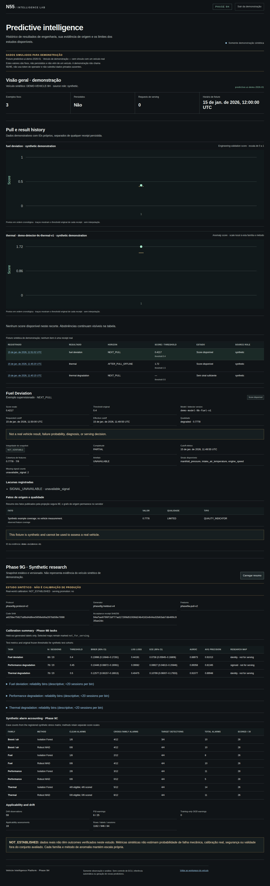
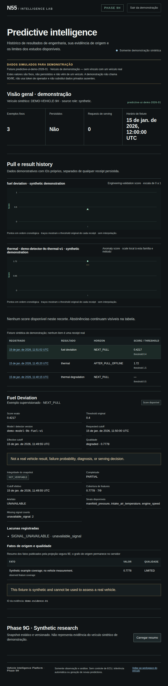
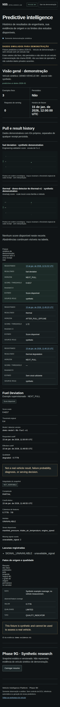

# Phase 9H UI evaluation

**Local synthetic browser review: PASS. Persisted browser review and final delivery: NOT VERIFIED.**
The captures below are actual Playwright Chromium screenshots of the explicitly labeled synthetic
demo. They do not represent persisted vehicle results.

## Screenshots

Desktop, tablet and mobile captures were visually reviewed after the final local Playwright run.
The page keeps the incumbent dark engineering style, separates the synthetic banner from private
operator data, displays exact scores and thresholds, retains table access to chart values, and
states scientific limitations next to the relevant result. Mobile stacks the metadata and history
rows without clipping. The synthetic research summary remains clearly labeled as a non-production
study.

The complete, uncommitted local screenshot set is also under ignored
`.validation/phase9h/screenshots/`. Docker-backed acceptance captures persisted operator, receipt,
evidence, research and mobile states separately as a CI artifact.

## Browser and chart measurements

Measured from the successful local Chromium synthetic-demo run on 2026-11-04:

| Measurement                                |                                    Result | Scope                                                                         |
| ------------------------------------------ | ----------------------------------------: | ----------------------------------------------------------------------------- |
| Operator page ready                        |                                 18,636 ms | Local Next.js development server; includes cold compile, not a production SLA |
| Synthetic demo interactive                 |                                  1,981 ms | Local Next.js development server                                              |
| Responsive overflow                        |              0 px at 1440, 768 and 390 px | Chromium document width                                                       |
| Axe violations                             |                                         0 | WCAG 2.2 AA-related tags on the 390 px synthetic screen                       |
| Browser page/console errors                |                                         0 | Captured page errors                                                          |
| Same-origin resources                      |                                         9 | Development run at 390 px                                                     |
| Client script transfer / decoded bytes     |              3,183,518 / 15,146,041 bytes | Development assets; not a production bundle budget                            |
| Full same-origin transfer / decoded bytes  |              3,196,913 / 15,183,912 bytes | Development run at 390 px                                                     |
| Synthetic fixture transfer / decoded bytes |                       5,916 / 5,916 bytes | Explicit demo endpoint                                                        |
| DOM nodes                                  |                                       237 | 390 px synthetic screen                                                       |
| Charts / each chart                        | 2 / 3 axes, 1 point, 1 original threshold | One scored synthetic record in each family                                    |

The bounded 500-point SVG benchmark rendered 500 points and 500 threshold marks in five jsdom
samples. Median was 507.52 ms, p95 was 609.85 ms, the chart rendered 2,518 nodes, and the
approximate heap delta was 59,189,208 bytes. This is a local component-render approximation, not a
browser or production SLA. Its JSON receipt is
`.validation/phase9h/playwright/chart-500-render.json`.

Playwright also checked keyboard Tab focus on the skip link, history selection, the abstained and
partial synthetic states, the local anomaly scale, and the research summary. The browser asserts
that the synthetic demo makes zero serving requests. No screenshot is evidence of statistical
validity.

## Remaining visual evidence

| View                                                                                 | Evidence                                 | Status                                      |
| ------------------------------------------------------------------------------------ | ---------------------------------------- | ------------------------------------------- |
| Synthetic desktop overview, history, anomaly, abstention, partial evidence, research | Committed Chromium screenshots above     | PASS                                        |
| Synthetic 768 px tablet and 390 px mobile                                            | Committed Chromium screenshots above     | PASS; zero horizontal overflow              |
| Persisted operator, receipt and evidence details                                     | Disposable DB + protected BFF + Chromium | **CI REQUIRED**; Docker unavailable locally |
| Persisted mode axe, secret-disclosure and network metrics                            | Exact-head Phase 9H workflow             | **CI REQUIRED**                             |

All displayed synthetic values are fixture values. Original persisted numerical parity can only be
claimed after the independent database oracle and exact-head browser acceptance pass.
